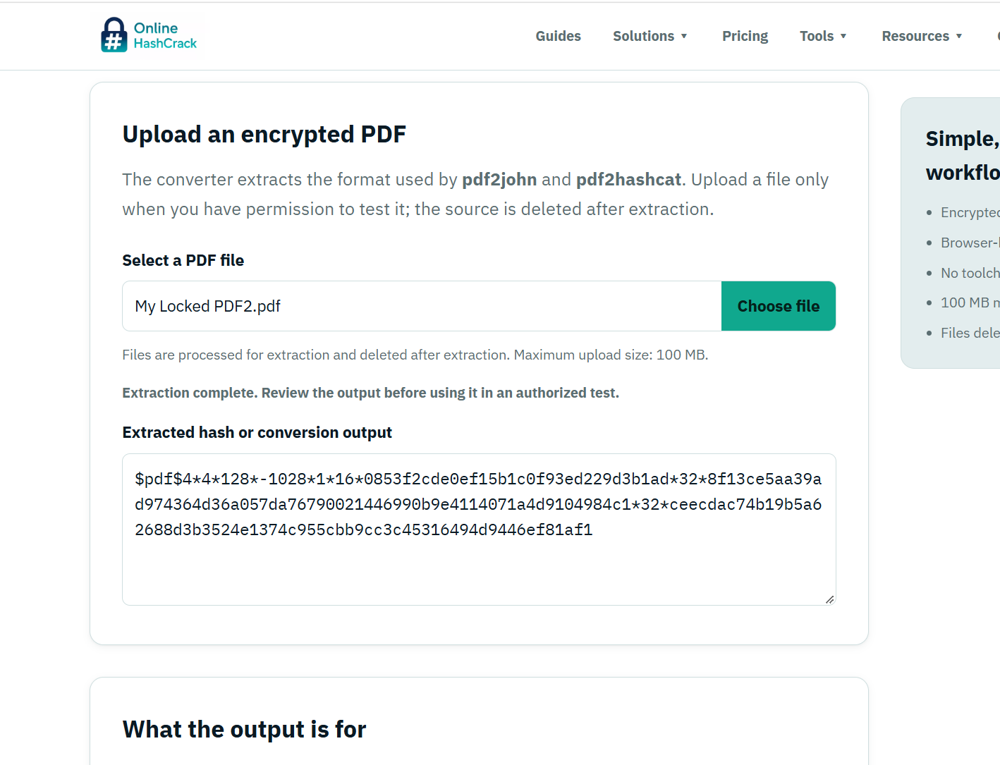

<div align="center">

# Cybersecurity Password Hashing

## Orgernized  and Sponsered by NetWorkwalks - B084


</div>

---

## Overview

This small Lab focuses on password hashing and password breaking using tools like JTR and NW hashing and breaking tools after the pentester gain access and some PDF document containing vital information are protected with password. 
## Contents

- [Objectives](#objectives)
- [Procedural steps](#lab-architecture)

## Objectives

Breaking PDF password protected files 


## Procedural Steps

- Install Johnny or using JTR in Kali terminal 
- Import the password encrypted file(PDF) to generate the hash code using pdf-hash-extractor.
- Save the generated hash as text file.
- Launch JTR and import the hash file
- Start new attack to crack the password 
- Unlock the encrypted PDF file with the password 

## Online PDF hash extractor and JTR
## Step 1
I first used the online extractor to generate the hash code by importing the protected PDF file 
https://www.onlinehashcrack.com/tools-pdf-hash-extractor.php
  


## Step 2
I copied the extracted hash and save it in a text file. This will enable me to import it into JTR


## Step 3
This step involves using JTR. I then open JTR and import the hash file, click on start new Attack to generate the password 


## Prerequisites

- A computer with hardware virtualization enabled (Intel VT-x or AMD-V).
- Oracle VM VirtualBox installed.
- Kali Linux VM image downloaded from the official Kali website.
- 7-Zip or another archive utility if the downloaded image is compressed.
- Sufficient disk space and memory for the virtual machine.

## Deployment procedure

### 1. Install the archive utility

Install [7-Zip](https://www.7-zip.org/) if the Kali VM package is supplied as a compressed archive. Extract the downloaded file to a suitable folder.

### 2. Install VirtualBox

Download and install [Oracle VM VirtualBox](https://www.virtualbox.org/wiki/Downloads). If the installer requests it, restart the host computer after installation.

### 3. Create the NAT Network

In VirtualBox, open **Tools → Network → NAT Networks** (the exact menu location may vary by VirtualBox version), then create a network with the following example settings:

| Setting | Value |
|---|---|
| Name | `NatNetwork` |
| IPv4 prefix | `10.0.0.0/24` |
| DHCP | Enabled initially; configure the pool to avoid static-address conflicts |
| IPv6 | Disabled for this example |

<div align="center">


<p><b>Figure 1:</b> Cybersecurity Virtual Lab - Nat configurations</p>

</div>

Attach all lab VMs that need to communicate with one another to this same NAT Network.

### 4. Import the Kali Linux VM

Download Kali from the [official Kali Linux download page](https://www.kali.org/get-kali/). Import the supplied appliance or create a VM using the downloaded virtual disk.

Example VM settings:

- **Memory:** 2,048 MB (increase if the host has sufficient available memory).
- **Network Adapter 1:** Attached to `NAT Network`.
- **Network name:** `NatNetwork`.
- **Adapter type:** Intel PRO/1000 MT Desktop, if compatible with the imported VM.

<div align="center">


<p><b>Figure 2:</b> Cybersecurity Virtual Lab - Installed Kali Linux</p>

</div>


A shared folder may optionally be configured for controlled file transfer between the host and guest. Install VirtualBox Guest Additions if required by the shared-folder setup.

### 5. Configure Kali networking

First identify the active interface and connection profile:

```bash
ip -br address
ip route
nmcli connection show
```

<div align="center">


<p><b>Figure 3:</b> Cybersecurity Virtual Lab - IPv4 Configurations</p>

</div>

For a simple lab, DHCP is suitable for initial connectivity testing. If a stable address is required, configure a static address using NetworkManager and the actual connection profile name.

Example only — verify the gateway and ensure `10.0.0.2` is not inside the DHCP allocation pool before applying:

```bash
sudo nmcli connection modify "Wired connection 1" \
  ipv4.method manual \
  ipv4.addresses 10.0.0.2/24 \
  ipv4.gateway 10.0.0.1 \
  ipv4.dns 8.8.8.8

sudo nmcli connection up "Wired connection 1"
```

If your connection profile has a different name, replace `Wired connection 1` with the name shown by `nmcli connection show`.

To return the profile to DHCP:

```bash
sudo nmcli connection modify "Wired connection 1" ipv4.method auto
sudo nmcli connection up "Wired connection 1"
```

### 6. Create a clean snapshot

After confirming that the VM boots and networking works, shut down or snapshot the VM and create a baseline snapshot.

Suggested name:

```text
Clean Kali - Network Baseline
```
<div align="center">
I first used the online extractor to generate the hash code by importing the protected PDF file 
https://www.onlinehashcrack.com/tools-pdf-hash-extractor.php
  


## References

- [Oracle VM VirtualBox — Downloads](https://www.virtualbox.org/wiki/Downloads)
- [Oracle VM VirtualBox — User Manual](https://www.virtualbox.org/manual/)
- [Kali Linux — Get Kali](https://www.kali.org/get-kali/)
- [Kali Linux Documentation](https://www.kali.org/docs/)
- [7-Zip — Downloads](https://www.7-zip.org/)

---

# 👤 Author

**Flash Amenkey**\
Cybersecurity Professional B084

LinkedIn: [https://www.linkedin.com/in/flash-amenkey-a82a0b15b/)

## Orgernized and Sponsered by NetWorkwalks
---

<div align="center">

**Built for learning, experimentation, and responsible security practice.**

</div>

