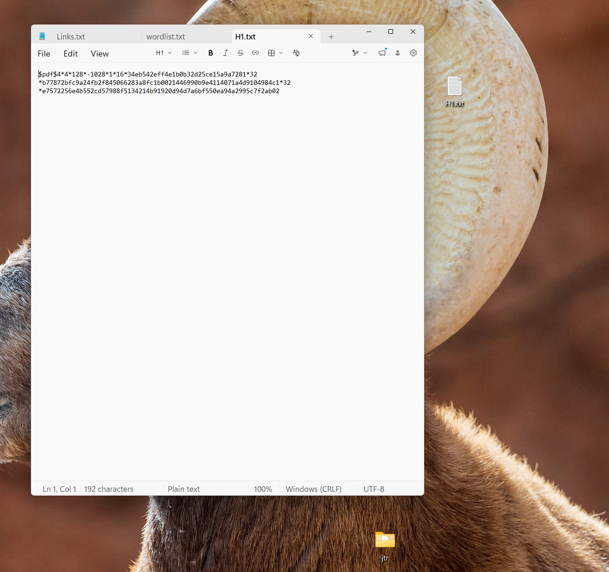
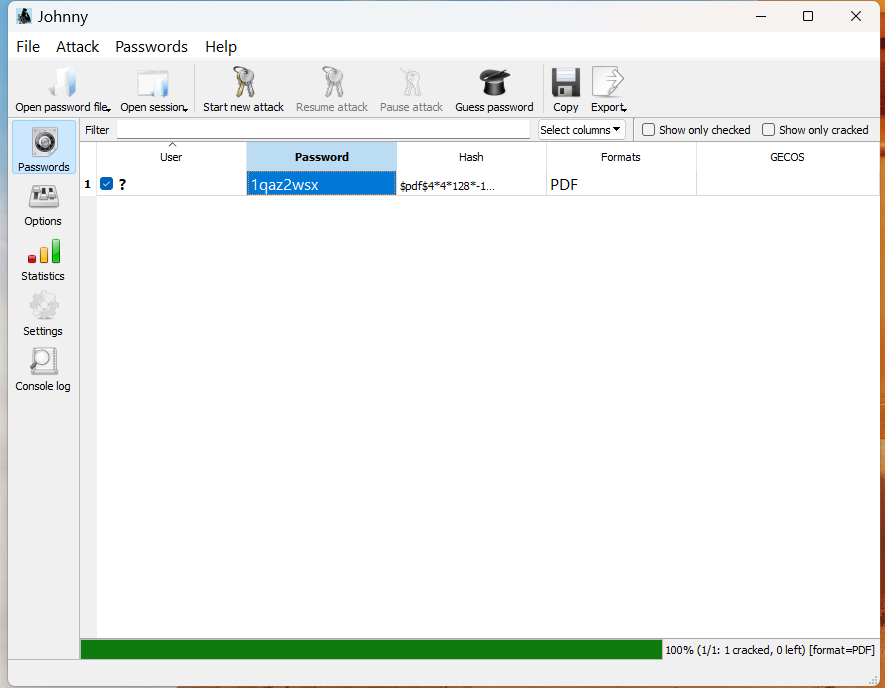
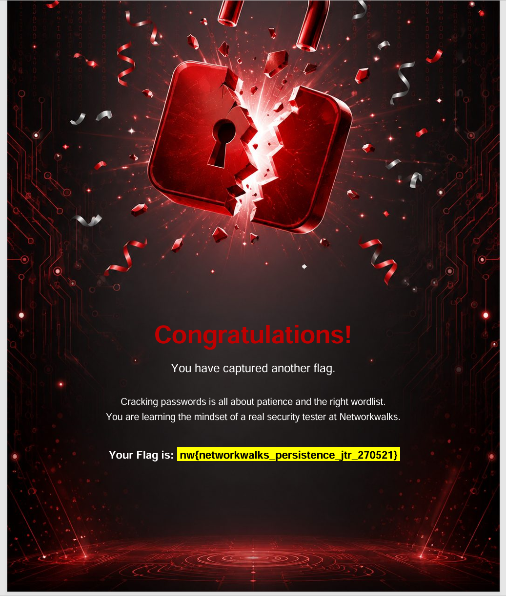
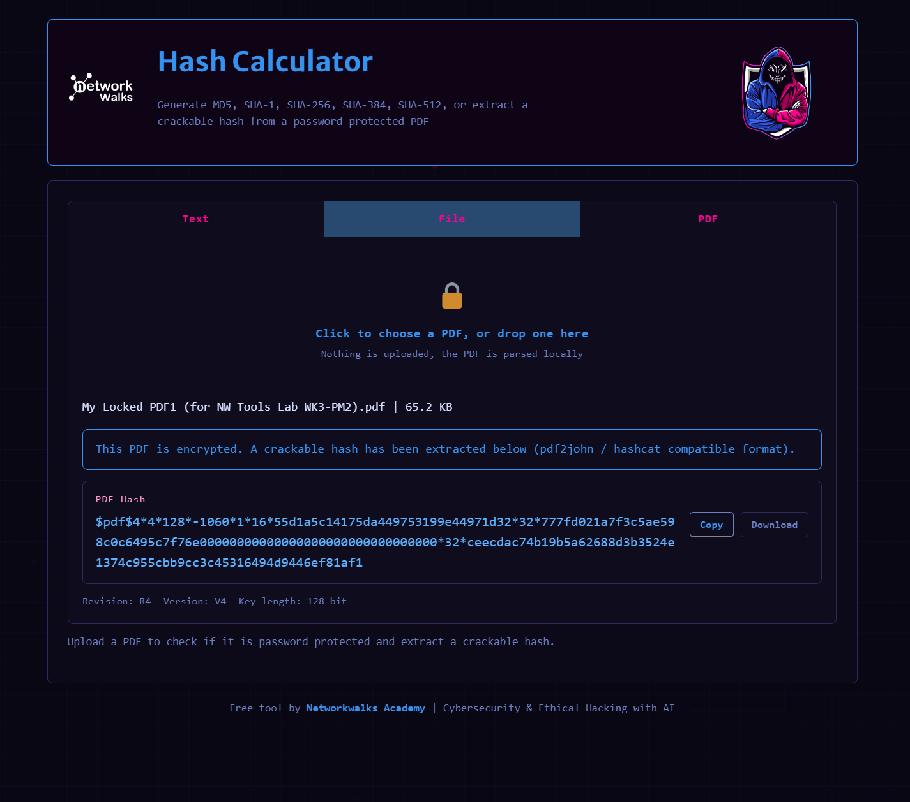
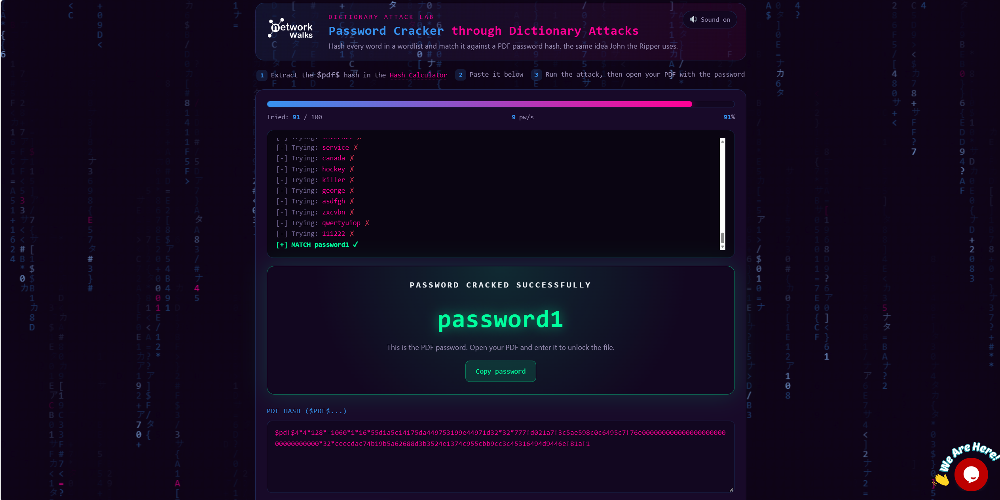

# Cybersecurity Password Hashing

## Orgernized  and Sponsered by NetWorkwalks - B084

---

## Overview

This small Lab focuses on password hashing and password breaking using tools like JTR and NW hashing and breaking tools after the pentester gain access and some PDF document containing vital information are protected with password. 
## Contents

- [Objectives](#objectives)
- [Procedural steps](#lab-architecture)

## Objectives

Breaking PDF password protected files 

## Procedural Steps

- Install Johnny or using JTR in Kali terminal 
- Import the password encrypted file(PDF) to generate the hash code using pdf-hash-extractor.
- Save the generated hash as text file.
- Launch JTR and import the hash file
- Start new attack to crack the password 
- Unlock the encrypted PDF file with the password 

## Online PDF hash extractor and JTR
## Step 1
I first used the online extractor to generate the hash code by importing the protected PDF file 
https://www.onlinehashcrack.com/tools-pdf-hash-extractor.php
  

## Step 2
I copied the extracted hash and save it in a text file. This will enable me to import it into JTR

## Step 3
This step involves using JTR. I then open JTR and import the hash file, click on start new Attack to generate the password 

## Step 4
The cracked password has been typed into the protected PDF and voila we had it.

## Networkwalks hash calculator and password breaker 
## Step 1
I first used hash calculaor to generate the hash code by importing the protected PDF file 
(https://networkwalks.com/hash-calculator/)
  

## Step 2
I copied the extracted hash and paste it in the password cracker to crack the password base on the hash code generated.
https://networkwalks.com/password-cracker/

## Step 3
The cracked password has been typed into the protected PDF and voila we had it.

## References

- [Online Hash Extractor](https://www.onlinehashcrack.com/tools-pdf-hash-extractor.php)
- [John The Ripper-JTR, Kali terminal and Windows version](https://openwall.info/wiki/john/johnny)
- [Networkwalks Hash Generator](https://networkwalks.com/hash-calculator/)
- [Networkwalks Password Creacker](https://networkwalks.com/password-cracker/)
---

# 👤 Author

**Flash Amenkey**\
Cybersecurity Professional B084

LinkedIn: [https://www.linkedin.com/in/flash-amenkey-a82a0b15b/)

## Orgernized and Sponsered by NetWorkwalks
---

**For learning, experimentation, and responsible security practice.**

